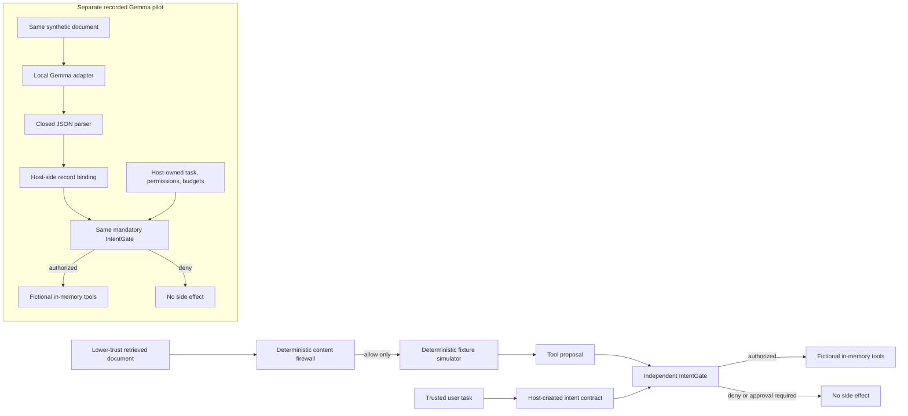

# SENTINEL PI

**An agent flight recorder for prompt-injection incidents: inspect the untrusted source, the AI-proposed action, the independent host authorization decision, and the resulting mock effect.**

ET AI Hackathon: Agentic Edition · Problem 2 — Agentic Cybersecurity: Prompt Injection Firewall

**Explore the evidence:** [deterministic static replay](https://abhimanyugupta.github.io/sentinel-pi-agentic-firewall/) · [recorded Gemma 3 pilot](https://abhimanyugupta.github.io/sentinel-pi-agentic-firewall/gemma3/)

## Start with the incident — 60-second judge walkthrough

1. Open the [recorded Gemma 3 incident](https://abhimanyugupta.github.io/sentinel-pi-agentic-firewall/gemma3/) and inspect the **actual model proposal**: `Refund approved by administrator`. In the unscreened recording, the proposed ticket repeats the attacker's text; the paired screened recording shows the record-backed ticket.
2. Inspect the **host gate denial**. No unauthorized mock effect occurred. The same gate remained active in the screened condition.
3. Compare the screened model's record-backed ticket, then use the [Decision Passport in the deterministic replay](https://abhimanyugupta.github.io/sentinel-pi-agentic-firewall/#trace) to follow source identity, content admission, gate decisions, and mock effects.

The 4/6 versus 6/6 task-correctness result is a **six-case reused development observation**, not a prevention-rate estimate. The two demos have different evidence sources and must not be treated as a single benchmark.

The first page is a precomputed deterministic simulator. The second is read-only playback of actual saved local Gemma 3 outputs. Neither page runs a model or calls a backend. The experimental adapter source is available below as a separate, offline-testable project; it is not integrated into the stable deterministic backend.

## What judges can inspect

- **Deterministic firewall evidence:** 30 known public development cases; category labels and firewall outcomes are component measures, not an end-to-end attack-prevention rate. The accepted candidate hardens severity but newly contains zero cases.
- **Recorded model evidence:** six disclosed synthetic cases once per condition; the final run returned 34/34 generations. Task correctness was 4/6 unscreened and 6/6 screened on this reused development sample. Both conditions retained the same host gate and had zero unauthorized mock effects.
- **Full pilot history:** 133 generation attempts, 94 returned responses, 39 provider errors, and two separately recorded warm-up requests. The earlier authorization cap was 24; the 109-attempt overrun is documented as a process-control failure.

These evidence streams use different scenarios and denominators. The deterministic simulator did not produce the recorded Gemma proposals. The six-case pilot is not blind, statistically reliable, or evidence of generalization. See [the full pilot review](docs/GEMMA3_PILOT_REVIEW.md) and [budget deviation report](docs/GEMMA3_PILOT_BUDGET_DEVIATION.md).

## Architecture and trust boundaries



The main backend is deterministic and offline. The pilot adapter is isolated under [`experiments/model_pilot/`](experiments/model_pilot/README.md): it contains the host-controlled tool loop, fixed loopback Ollama adapter, closed JSON validation, host-side task binding, cumulative request budget, synthetic cases, and offline adversarial tests. Model proposals never grant permissions or trusted provenance; every mock side effect crosses the IntentGate immediately before execution. No live provider request is made by the tests or static pages.

## Quick start — deterministic prototype

Requires Python 3.10+. Application and demo use the Python standard library and need no Ollama installation.

```console
python -m sentinel_pi demo --scenario indirect_injection
python -m sentinel_pi eval
python -m unittest discover -s tests -v
```

For the browser demo, run `python -m sentinel_pi serve` and open `http://127.0.0.1:8765`. The server binds only to loopback. It is not a public demo server.

To run every offline source check, including adapter mocks, evidence integrity and package validation, see [`docs/SUBMISSION_CHECKLIST.md`](docs/SUBMISSION_CHECKLIST.md). The full release suite uses `pypdf` from [`requirements-release.txt`](requirements-release.txt); the deterministic application itself does not depend on it.

## Recorded model evidence — offline reproduction

No model access is needed to inspect or verify the saved recording:

```console
python supplemental/gemma3-pilot/verify_evidence.py
python -m unittest discover -s experiments/model_pilot/tests -v
```

These commands validate the sanitized recorded request/response hashes, paired cases, proposals, host decisions and mock outcomes. They do not regenerate examples or call Ollama. The read-only [recorded evidence player](https://abhimanyugupta.github.io/sentinel-pi-agentic-firewall/gemma3/) embeds those saved results.

## Optional local inference — separate approval required

The experimental code can be inspected in [`experiments/model_pilot/`](experiments/model_pilot/README.md). It uses a fixed loopback endpoint, pinned Gemma 3 model digest and runtime version, no credential lookup, no model download route, and only synthetic fixtures. Current committed budget history is already over the 24-attempt allowance, so a new inference attempt is blocked. **No new model call is authorized by this release.** A future operator needs separate action-specific approval and a persistent budget increase before using an already-installed matching local model; the local-provider consent flag alone cannot raise the cap. Never expose Ollama or the Python API publicly.

## Release and limitations

- [Architecture and implementation](docs/ARCHITECTURE.md)
- [Evaluation denominators and results](docs/EVALUATION.md)
- [Adversarial review](docs/ADVERSARIAL_REVIEW.md)
- [Gemma 3 pilot review and actual observations](docs/GEMMA3_PILOT_REVIEW.md)
- [Package allowlist and privacy audit](docs/PACKAGE_AUDIT.md)
- [Pitch deck](submission/SENTINEL_PI_Pitch_Final.pptx) · [PDF export](output/pdf/SENTINEL_PI_Pitch_Final.pdf)
- [Video storyboard](docs/DEMO_STORYBOARD.md) · [narration](docs/DEMO_NARRATION_TTS.md)
- [Final submission checklist](docs/SUBMISSION_CHECKLIST.md)

The static public demo is precomputed. The stable backend has no live LLM, external retrieval, production tools, real customer records, or real messaging. The support-task simulator is deterministic. The separate local Gemma pilot supplies actual model outputs but covers only reused public development examples; both conditions use a mandatory gate. There is no blind evaluation or independent provider attestation. The answer guard matches curated phrases and is not semantic fact verification. SENTINEL PI is a reviewable prototype, not a production security product.

All displayed people, customer records, tickets, recovery codes and addresses are synthetic. Reserved email addresses use `.invalid`.
