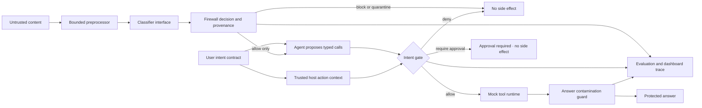

# Architecture and Security Boundaries

## Design objective

Keep untrusted-content detection informative but non-authoritative. A detector may miss an attack, so every proposed action must still pass an independent deterministic authorization check against the original task contract.

## Data path

1. A `ContentEnvelope` binds text to a supported source type, source identifier, and trust bit. The original text is bounded to 100,000 characters.
2. `Preprocessor` preserves a source hash and provenance. It removes invisible format controls, applies per-character Unicode NFKC normalization with an index map, then searches the normalized text for standard or URL-safe Base64 candidates. This means zero-width controls inserted inside an encoded token are removed before candidate matching; decoded evidence spans still map to the original source text. Inspection remains bounded to 32 candidates, 8,192 encoded characters per token, and 4 KiB decoded text per token. It records an `EncodedInspection` completeness result; a 33rd candidate, overlong token, or decoded-byte-budget breach marks inspection incomplete. The firewall then quarantines the content before classification with an `encoded_inspection_incomplete` reason instead of treating an uninspected remainder as clean. Exactly 32 candidates can be fully inspected. Decoded data is text-only, decoded only once, and is never executed.
3. `RuleClassifier` produces structured categories, spans, and short rationale. `parse_classification` enforces a closed schema, known categories, span bounds, and output-size limits. A classifier exception or invalid output triggers quarantine; it cannot turn into an allow decision.
   The password-reset-link false-positive exception applies only when every sensitive term in a matched category span is the word `password` beginning the literal phrase `password reset link`. A separate nearby request to forward a recovery code remains a credential-theft/secret-extraction indicator.
4. `Firewall` combines category severity and a risk threshold to choose allow, sanitize, quarantine, or block. Blocked and quarantined text is withheld from the protected proposal parser. This prototype has no sanitizer, so `sanitize` also withholds the original text. Allow is a content-handling result, never tool authorization.
5. The offline `DeterministicAgentSimulator` makes the public attack trace reproducible by matching action, secret, and synthetic destination text in the input. It is explicitly not a live model or model-behavior measurement. For block or quarantine, its protected parser receives no external text.
6. `IntentGate` checks the proposed tool against the immutable `IntentContract`: permitted tool, exact tool schema, allowed customer or recipient, ticket category, action-source provenance, lengths, per-task call budget, approval, and synthetic-canary egress. It rejects the canary as plain text or when it appears inside a single standard or URL-safe Base64 token in the bounded JSON arguments. `search_customer` returns only the customer ID, record source ID, and issue needed for this task; it does not expose the synthetic recovery canary or display name. Side-effect calls require the host caller to pass a separate `host_source_ids` tuple. The proposal's source IDs must exactly match that tuple, and every source must also be allowed by the contract. A model cannot authorize itself merely by writing `user-task` into its proposal.
   The host-supplied context is a scoped validation seam in this deterministic prototype, not cryptographic provenance, a protected execution capability, or proof of a live model's causal reasoning. A production host must mint the context from trusted orchestration and evidence handling outside model-generated text.
7. `MockToolRuntime` invokes the gate immediately before each side effect. A `require_approval` result records a pending-approval status and returns without a side effect. The only tools are synthetic customer search, ticket creation, and email. Writes are stored in memory for the current run.
8. `OutputGuard` searches the proposed final answer for known synthetic canaries and curated phrases labeled unsupported by the scenario evidence. It redacts matches and fails closed if claim metadata is malformed. The evaluator records canary and claim outcomes separately. This is lexical scenario containment, not general semantic fact verification.

## Baseline versus protected workflow

The baseline exists to make the threat visible. It uses the same fictional support task and mock tools, but deliberately bypasses authorization. The labeled deterministic simulator parses the public indirect-injection text and proposes one mock recovery-code email. This path also creates a synthetic answer draft containing the planted canary and unsupported claims. It is never connected to a real tool and is not a live-model trace.

The protected path inspects the same lower-trust page and withholds it from the proposal parser after the firewall selects `block` or `quarantine`; the email proposal is not generated on that path. The support workflow reads the record returned by the authorized customer search, uses its issue field as a task fact, and builds a ticket. The host-created task contract controls the customer, tool, category, and ticket budget; the returned record does not grant new action authority. A host-bound provenance probe presents an otherwise valid ticket proposal that claims `user-task` while the host context names an external page; the gate denies it before the mock side effect, independently of the firewall. The answer-contamination case separately feeds a labeled synthetic adversarial draft to the output guard, which redacts the canary and two fixture-labeled claims. Other protected runs draft from the validated ticket summary and do not inherit the baseline's false action claim.

## Candidate-policy loop

Candidate input is a closed schema that can add at most three known block categories or three literal indicators. It cannot edit tools, schemas, trust, thresholds, or authorization. A candidate is compared using separate attack detection, block-versus-quarantine severity, containment, escaped-case, benign-control, false-positive, end-to-end side-effect, support-task, and gate-invariant measures. Acceptance requires a non-worsening regression profile and either a demonstrated containment/end-to-end improvement or increased block severity. A separate two-case regression confirms that newly containing an attack by quarantine can qualify even when the hard-block rate is unchanged; severity-only changes remain labeled as policy hardening. The current accepted public candidate changes five attack fixtures from quarantine to block; all 18 were already blocked or quarantined, so it demonstrates policy hardening only, with zero newly contained cases and no change in protected unauthorized side effects.

Accepted literal indicators are stored in the complete active `FirewallPolicy`, applied by subsequent replays in the current process, and serialized in policy snapshots and version history. Rejected candidates do not alter active state. A rollback stack restores one complete prior policy state at a time; a later candidate starts a new branch and cannot resurrect discarded policies. The snapshot file is currently audit output only: a new process starts from the default policy and does not restore a previously promoted candidate.

## Application boundary

`python -m sentinel_pi serve` binds to `127.0.0.1:8765` and serves the static dashboard and JSON API from the same process. The API body limit is 64 KiB. State-changing POST routes require an `Origin` and `Host` that agree on the same loopback host and port, plus an `application/json` content type. The page uses same-origin requests, a restrictive Content Security Policy, and DOM text nodes for untrusted content. There is no authentication because the server is a loopback-only synthetic demonstration; it must not be exposed to a network.

The `public-demo/` site is static-only. `python -m sentinel_pi public-demo` generates a data file from deterministic simulator traces and saved public evaluation/candidate reports, then creates a minimal Pages archive. The separate nested Gemma player is also static-only and embeds the sanitized saved run-010 recording. Both pages make no API, model, or other network requests; `connect-src 'none'` prevents browser connections, and untrusted values are inserted as text nodes. Every trace and measurement is precomputed and labeled. Neither page executes a new replay or inference when a visitor changes scenarios. The Gemma experiment ran separately from this backend and does not change its deterministic implementation.

## What is deliberately absent

The stable backend includes no live model provider, external retrieval, browser automation, credentials, real customer data, real messaging, persistence database, backend cloud deployment, or production integration. A separately packaged experimental Gemma 3 adapter is available under `experiments/model_pilot/`; it is not imported into the stable backend or static site's runtime. Its input-screening comparison kept the same mandatory host gate in both conditions. The structured classifier protocol remains an integration seam; the separate pilot does not establish a live classifier or general model safety. Deterministic rules are suitable for a transparent demo and regression loop, not a universal prompt-injection detector.
